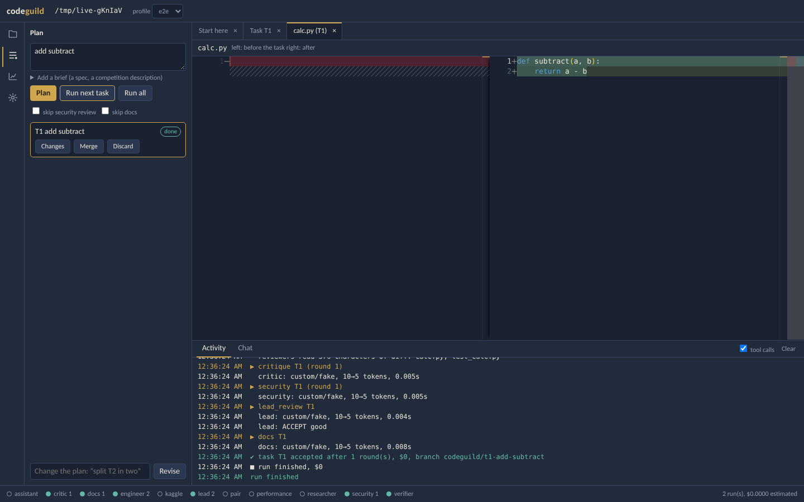

# codeguild

**A budget-aware AI engineering team for your codebase.**
A Lead plans, an Engineer implements on a branch, a Verifier runs your tests, a Critic and a
Security reviewer push back, the Lead signs off, and a Writer updates the docs.
Every seat is filled by whatever model your budget allows — local Ollama for £0, a
frontier model only where it earns its cost, or the best model everywhere.

```
you ──goal──▶ Lead ──tasks──▶ Engineer ──branch──▶ Verifier ──▶ Critic + Security ──▶ Lead ──▶ Docs
                ▲                  ▲                   │              │                  │
                └── replan ────────┴── revise (≤N) ────┴──────────────┘        you merge ◀┘
```

- **Three profiles, one config switch:** `free` (Ollama + free tiers, never spends), `lite`
  (~£10–20/month: Claude plans and reviews, local model codes, cheap APIs critique),
  `pro` (Fable leads, Opus codes, GPT critiques, Gemini documents).
- **Roles are YAML.** Prompt + model slot + tool permissions. Drop a file in `.codeguild/roles/`
  to add or override one. No code changes.
- **Fallback chains.** Every slot lists candidates in order; unreachable or unpaid ones are
  skipped. Escalates the Engineer to a stronger model after repeated failures.
- **Deterministic verification.** Tests are run by codeguild, not by a model, so a pass is a real pass.
- **Validated outputs.** Every role's reply is checked against a schema; malformed replies are
  sent back with the error for repair, so weak models degrade gracefully instead of derailing.
- **Hardware-aware setup.** `codeguild init` reads your VRAM/RAM and Ollama and writes a profile
  with models that actually fit — no 30b models on an 8 GB GPU.
- **Small-model friendly.** If a local model writes a tool call as text instead of using the protocol, codeguild executes it anyway.
- **Guardrails.** Tools are scoped to the project directory. Reviewers are read-only. The
  Writer can only touch Markdown. API keys are stripped from every subprocess. Nothing is
  merged to `main` by the tool — you review the branch.
- **Full JSONL trace** of every model call, tool call, decision and test run with token
  counts and provenance, plus `codeguild cost` to see where money went.
- **Any OpenAI-compatible endpoint** (Ollama, Groq, Gemini, DeepSeek, OpenRouter, Mistral,
  OmniRoute, LiteLLM, vLLM…) plus Anthropic natively.

MIT licensed. Python 3.10+.



The dashboard (`codeguild ui`) is a small IDE: browse and edit files, read what a task changed
file by file, approve an agent's edits from a diff, and chat with the team.

> Until the first PyPI release, install from a clone: `pip install -e ".[ui]"`. This project was
> called `guild` before 0.3.0; existing projects are carried over automatically.

## Quick start

```bash
pip install "codeguild[ui]"       # or: pip install -e ".[dev]" from a clone

cd your-project
codeguild init                       # wizard: detects GPU/RAM, Ollama, keys, test runner → picks models that fit
codeguild doctor                     # shows which models are reachable and what to pull
codeguild plan "Add a REST endpoint that returns the top 10 users by score, with tests"
codeguild run                        # runs the next task: engineer → verify → review → docs
git diff main...codeguild/t1-...     # inspect the branch, then merge it yourself
```

### Free profile (no keys)

Install [Ollama](https://ollama.com) and pull a coder model:

```bash
ollama pull qwen2.5-coder:7b     # ~5 GB, fine on 16 GB RAM
ollama pull qwen3-coder:30b      # better, needs ~20 GB RAM (or a GPU)
ollama pull deepseek-r1:14b      # reasoning model for critique/security
```

Optional free cloud fallbacks: set `GROQ_API_KEY` and/or `GEMINI_API_KEY` (both have free
tiers). The free profile has a `$0` cap — it will refuse to use a paid model even if a key
is present.

### Lite profile (~£10–20/month)

```bash
export ANTHROPIC_API_KEY=...     # Lead + escalation
export DEEPSEEK_API_KEY=...      # Critic / Security (very cheap)
export GEMINI_API_KEY=...        # Docs (free tier is enough)
codeguild init . --profile lite
```

The Engineer still runs on Ollama. Claude is called for planning, for the final review of
each task, and for coding only after the local model fails verification twice. Each run is
capped at `$2` by default (`limits.max_usd_per_run` in the profile).

### Pro profile

```bash
export ANTHROPIC_API_KEY=... OPENAI_API_KEY=... GEMINI_API_KEY=...
codeguild init . --profile pro
```

## Dashboard

```bash
pip install "codeguild[ui]"      # adds fastapi + uvicorn
cd your-project && codeguild ui     # opens http://127.0.0.1:7331
```

Everything the CLI does, in a browser tab, plus the parts a CLI can't do well:

- **Project picker** — the header shows the folder the team is working in; click it to browse
  your machine or pick a recent project and switch without restarting.
- **Chat** — ask the Assistant anything about the code, the plan or what the team did. It reads
  files, searches and runs tests to answer, streams its reply, and remembers the conversation.
  It never edits.
- **Files** — browse and read every file in the project (code, docs, configs).
- **Plan by prompting** — type "split T2 in two and add input validation" under the plan and
  the Lead rewrites it, keeping finished tasks.
- Type a goal → **plan**; tick tasks → **run selected**; model output streams live; every
  tool call, test result and review decision appears as it happens.
- When a task is accepted, **diff** shows the branch and **merge** merges it (codeguild never
  merges on its own). Click a run under **runs & cost** for a full timeline with per-role cost.

Binds to localhost only; nothing to deploy.

## Project docs: give the team context

`codeguild init --docs` scaffolds `docs/PRD.md`, `docs/ARCHITECTURE.md`, `RULES.md`, `TASKS.md`,
`docs/MEMORY.md` and `docs/DECISIONS.md` in your project (nothing existing is overwritten).
Fill in the PRD at least. Every role reads whichever of these exist: the Lead stays inside
the PRD's scope and continues from TASKS/MEMORY; the Engineer follows ARCHITECTURE and RULES;
the Docs role ticks TASKS and updates MEMORY after each accepted task. `CLAUDE.md` and
`.cursorrules` are picked up as rules too, so a repo set up for Claude Code or Cursor works
as-is.

## Commands

| command | what it does |
|---|---|
| `codeguild init [path] [--profile P] [--docs] [-y]` | wizard: hardware → profile, test runner, git init, optional project docs |
| `codeguild doctor` | check every model in the active profile: reachable / key set / not pulled |
| `codeguild plan "goal" [--context brief.md]` | Lead writes roadmap + tasks → `.codeguild/plan.json` |
| `codeguild status` | show the plan and task states |
| `codeguild run [T1 T3 ...] [--all] [-y] [--skip security,docs]` | implement task(s) through the full loop |
| `codeguild review [--ref main] [--security-only]` | Critic + Security on the current diff, nothing else |
| `codeguild ask ROLE "question"` | ask one role (e.g. `researcher`, `security`) about the project |
| `codeguild trust [-y]` | approve the `.codeguild` configuration that came with a cloned repository, after reading it |
| `codeguild pair ["request"] [--mode ask\|auto-edits\|plan]` | pair-program in the terminal: an agent that edits your working tree and asks before every change |
| `codeguild cost` | token + estimated cost table from saved traces |
| `codeguild roles` | list roles and profiles (built-in + project overrides) |
| `codeguild ui [--port 7331]` | local IDE-style dashboard: files, editor, task diffs, approvals, chat |
| `codeguild watch [--roles critic,security,performance] [--once]` | review every new commit as it lands |

`-p PROFILE` overrides the profile for one command. `-C DIR` runs against another project.

## Pair programming (interactive mode)

The pipeline (`codeguild run`) works on its own branch and hands you a diff at the end. Pair mode is
the other way of working: a chat where the agent reads, edits and runs commands in your working
tree while you watch, and **every file change and every non-inspection command waits for your
approval**. No branch, no commit — you are the reviewer.

```
codeguild pair "add a --verbose flag to cli.py"      # or just `codeguild pair` and type
```

It shows a diff and asks `apply? [y]es / [n]o / [a]ll edits this session`; anything else you
type is sent back to the agent as the reason. `/mode plan` makes it read-only (explore and
propose), `/mode auto-edits` applies file edits directly and still asks for commands. Ctrl+C
cancels the current turn. The same thing is available in the dashboard chat (mode selector next
to *send*, plus a *stop* button) and in the VS Code extension (`vscode-extension/`), where the
proposed change opens in VS Code's diff editor.

## Roles

| role | slot | tools | job |
|---|---|---|---|
| **lead** | frontier | read, search, tests | roadmap, task breakdown, accept/revise/replan, improvement suggestions |
| **engineer** | coder → coder_escalation | read/write/edit, shell, tests, git | implement one task on a branch with tests |
| **verifier** | — | — | not a model: codeguild runs your `test_command` (and `lint_command`) itself and reports exit code, counts and failures |
| **critic** | reasoner | read, search, diff | adversarial code review with severity-ranked findings |
| **security** | reasoner | read, search, diff, shell (read-only) | secrets, injection, deps, privacy, CI/supply-chain |
| **docs** | cheap | read, write (Markdown only) | README / CHANGELOG / docs after each accepted task |
| **researcher** | cheap | read, search, web | "how should we do X?" with trade-offs and sources |
| **performance** | reasoner | read, search, diff, shell (read-only) | complexity, N+1, memory, blocking I/O — via `ask` or `watch` |
| **kaggle** | frontier | read, search, web | turns a competition brief into a baseline + CV + submission plan |
| **assistant** | frontier | read, search, diff, tests | the chat: answers questions about the project in prose; read-only |

Add your own: copy any `src/codeguild/data/roles/*.yaml` into `.codeguild/roles/`, edit the prompt,
slot and tools, and add its name to `roles_enabled` in `.codeguild/config.yaml`. Ideas: a
`performance` reviewer, a `ux` reviewer for front-end work, a `kaggle` role that reads the
competition brief and proposes a baseline.

## Profiles

A profile maps abstract **slots** to a fallback chain of concrete models:

```yaml
slots:
  frontier: [anthropic/claude-fable-5-1, anthropic/claude-sonnet-5, ollama/qwen3-coder:30b]
  coder:    [ollama/qwen3-coder:30b, ollama/qwen2.5-coder:7b, deepseek/deepseek-chat]
  reasoner: [deepseek/deepseek-reasoner, gemini/gemini-2.5-flash]
  cheap:    [gemini/gemini-2.5-flash, ollama/qwen2.5-coder:7b]
limits:
  max_revision_rounds: 3     # engineer ↔ reviewers loops per task
  escalate_after: 2          # failed rounds before using coder_escalation
  max_usd_per_run: 2.0       # hard stop
```

Model ids are `provider/model`. Providers: `ollama`, `anthropic`, `openai`, `groq`, `gemini`,
`deepseek`, `openrouter`, `mistral`, `omniroute`, `litellm`, `custom` (set
`CUSTOM_OPENAI_BASE_URL`). Copy a profile into `.codeguild/profiles/` to customise it.

Prices used for estimates live in `src/codeguild/providers/router.py` (`DEFAULT_PRICES`);
local models cost 0. They are list-price approximations — check your provider's dashboard
for the real bill.

## Configuration (`.codeguild/config.yaml`)

```yaml
profile: lite
test_command: python -m pytest -q
lint_command: ruff check .          # optional; verifier runs it if set
sandbox: local                      # or docker (project bind-mounted, no network)
docker_image: python:3.11-slim
roles_enabled: [lead, engineer, verifier, critic, security, docs]
ignore: [.git, .codeguild, node_modules, .venv, __pycache__, dist, build]
```

## Traces

Each run writes `.codeguild/runs/<run-id>/trace.jsonl`. One JSON object per line:

```json
{"seq": 7, "ts": 1758375000.1, "run_id": "…", "kind": "model_call", "role": "engineer",
 "slot": "coder", "model": "ollama/qwen3-coder:30b", "input_tokens": 3120, "output_tokens": 410,
 "usd": 0.0, "latency_s": 8.2, "n_tool_calls": 2, "stop_reason": "tool_calls", "content_preview": "…"}
```

Kinds: `run_start`, `phase`, `model_call`, `tool_call`, `fallback`, `verification`,
`decision`, `task_end`, `run_end`. Load with `pandas.read_json(path, lines=True)`.
Traces may contain code excerpts, so `codeguild init` git-ignores them.

## Using it for a Kaggle competition

```bash
codeguild init                       # pick lite if you have an Anthropic key; the kaggle role wants a strong model
codeguild ask kaggle "Plan a baseline for this competition" --context competition_brief.md   # or paste the brief in the dashboard
codeguild run --all                  # T1: data + CV script, T2: baseline + submission.csv, then experiments
```

The `kaggle` role produces a plan in the same format as the Lead, so its tasks run through
the normal engineer → verify → review loop.

## In CI

`docs/github-action.yml` posts a Critic + Security review on every pull request using free
Gemini (and optionally DeepSeek) keys. Copy it into your repo's `.github/workflows/`.

## Safety model

- All file tools resolve inside the project root; `../` escapes are refused.
- Critic, Security and Verifier are read-only. Docs can only write `*.md`.
- Subprocesses run with `*KEY*`, `*TOKEN*`, `*SECRET*`, `*PASSWORD*` env vars removed.
- `sandbox: docker` runs commands in a throwaway container with no network.
- codeguild creates and commits to `codeguild/<task>` branches only when the tree is clean; it never
  merges, pushes, or touches `main`.
- The `free` profile refuses any model with a non-zero price. Every profile has a per-run cap.

This is still an LLM writing code: read the diff before you merge.

## Development

```bash
git clone https://github.com/<you>/codeguild && cd guild
pip install -e ".[dev]"
pytest              # ~50 tests, no API needed (scripted fake provider)
```

Layout:

```
src/codeguild/
  cli.py            typer commands
  ui/server.py      FastAPI dashboard (codeguild ui) + SSE event hub
  ui/index.html     the IDE-style dashboard page (no build step)
  ui/vendor/monaco  the Monaco editor, shipped in the package
  workflow.py       Guild: plan / run_task / run_tasks / pair / ask
  plan.py           Task, Plan, PlanStore (.codeguild/plan.json)
  repo.py           every git command; a task's branch
  verify.py         run tests + lint, detect removed tests
  paths.py          where things live under .codeguild/
  agent.py          one role's tool-calling loop + repair retries
  schemas.py        output contracts per role (pydantic)
  hardware.py       GPU/RAM/Ollama detection, model recommendations, test-runner detection
  config.py         Profile / Role / ProjectConfig loading
  trace.py          JSONL trace
  sandbox.py        local + docker command runners
  tools/registry.py file, search, shell, git, web tools
  tools/context.py  path scoping + a role's permissions
  tools/policy.py   what read-only roles may run, where web_fetch may go
  providers/        openai_compat, anthropic, router (fallback + cost)
  data/roles/       built-in role YAMLs
  data/profiles/    free / lite / pro
```

## Docs

- [Troubleshooting](docs/TROUBLESHOOTING.md)
- [Adding a role](docs/ADDING_A_ROLE.md)
- [CHANGELOG](CHANGELOG.md)

## Roadmap

- [ ] parallel engineers on independent tasks (per-task worktrees)
- [ ] `ux` and `data-quality` reviewer roles
- [x] VS Code extension (`vscode-extension/`)
- [x] IDE-style dashboard with a built-in editor
- [ ] first release on PyPI
- [ ] optional CI job that runs the loop against a real Ollama

## License

MIT — see [LICENSE](LICENSE).
